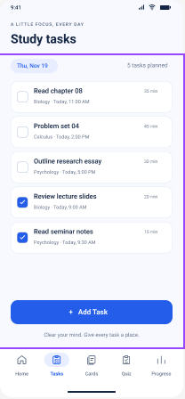
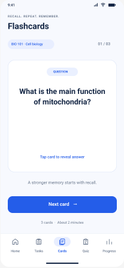
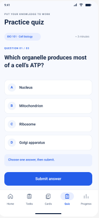
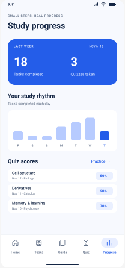

StudySprint — Project Spec
Course: CodePath AND101
Developer:Keoni Perez Labrador (solo project)
Status: Milestone 1 — Planning
App Overview
Description
StudySprint is an Android study companion that helps students manage study tasks, make and review their own flashcards, and take quick general-knowledge quizzes. The goal is to make short, focused study sessions easy to fit into a busy college schedule.
App Evaluation
Criterion	Score (1–5)	Evaluation
Mobile	4	Quick flashcard reviews, tap-to-reveal answers, and study sessions fit naturally on a phone.
Story	5	Students need a simple way to organize studying and practice material.
Market	5	College and high school students are a clear target audience.
Habit	5	Tasks, flashcards, and short quizzes encourage repeated use.
Scope	4	The solo MVP uses a few screens, local storage, and one straightforward API.

Total proposed score: 23/25. These are subjective planning ratings, not market research.
App Spec
Step 2a — User Features
Required (MVP) User Stories
- [ ] As a student, I can add a study task with a title and due date so I know what to work on.
- [ ] As a student, I can view my study tasks and mark them complete.
- [ ] As a student, I can create flashcards with a question and an answer.
- [ ] As a student, I can browse my flashcards and tap a card to reveal its answer.
- [ ] As a student, I can choose a quiz category and start a short practice quiz using questions from an online API.
- [ ] As a student, I can select an answer and see whether it is correct.
- [ ] As a student, I can see my score at the end of a quiz.
Optional (Nice-to-Have) User Stories
- [ ] As a student, I can receive reminders for upcoming study tasks.
- [ ] As a student, I can select quiz difficulty.
- [ ] As a student, I can track a study streak and past scores.
- [ ] As a student, I can group flashcards into decks by class.
- [ ] As a student, I can edit or delete flashcards and tasks.
- [ ] As a student, I can customize the app's appearance with dark mode.
Step 2b — API
Chosen API: Open Trivia Database (OpenTDB)

Why this API: It provides ready-made general-knowledge multiple-choice questions, categories, and difficulty metadata in JSON. It is free and does not require an API key. These quizzes are general trivia, not automatically generated from the student's class notes.

Endpoints and information used:
1. GET https://opentdb.com/api_category.php
   - Data: trivia_categories[].id, trivia_categories[].name
   - Corresponding feature: user browses and chooses a quiz category.
2. GET https://opentdb.com/api.php?amount=5&type=multiple&category={id}
   - Data: results[].question, results[].correct_answer, results[].incorrect_answers, results[].category, results[].difficulty
   - Corresponding features: user takes a 5-question quiz, chooses an answer, sees correctness, and gets a final score.
Implementation notes: Shuffle the correct answer among incorrect answers on the device. OpenTDB may return HTML-encoded entities; decode them for display. Handle empty results, network errors, and rate limits. Flashcards and study tasks are created by the user and saved locally; they do not come from OpenTDB.
Step 2c — User Interaction
Information or action	What the user sees	How the user interacts
Quiz categories (API)	List of subject categories	Tap Practice Quiz, then tap a category.
Quiz question (API)	A question and four shuffled answer choices	Tap Start Quiz to load five questions.
Correct/incorrect answers (API)	Feedback after selecting an option	Tap a radio-style option or answer button; press Next.
Quiz score (calculated locally from API answers)	Final result, e.g., 4/5	Tap Finish after the last question; tap Try Again to restart.
Flashcard question and answer (local data)	A flashcard with its front side	Tap Add Flashcard, type both sides, tap Save; tap a card to flip it.
Study tasks (local data)	A list of tasks and completion status	Tap Add Task, enter title/date, tap Save; tap checkbox to complete.

Main Screens / Layout
1. Home: App name, simple navigation buttons for Tasks, Flashcards, and Practice Quiz.
2. Tasks: Scrollable task list, add-task action, completion checkboxes.
3. Flashcards: List of cards, add-card form, tap-to-flip review view.
4. Quiz Setup: Category list fetched from OpenTDB and a Start button.
5. Quiz: Question, four answers, feedback, Next button, progress counter.
6. Quiz Results: Final score and a Try Again button.
Navigation flow: Home → Tasks / Flashcards / Quiz Setup → Quiz → Results → Home.
MVP Boundaries / Development Plan
- Build as a solo Android app in Android Studio using the Android UI tools taught in AND101.
- Store tasks and flashcards locally; start with a lightweight local persistence approach.
- Fetch trivia questions via HTTPS and parse the JSON response.
- Do not include login, cloud syncing, AI-generated course questions, or collaboration in the MVP.
- If the project timeline gets tight, finish the API-based quiz flow first, then add flashcards and tasks.
API References
- OpenTDB documentation: https://opentdb.com/api_config.php
- Get categories: https://opentdb.com/api_category.php
- Example quiz request: https://opentdb.com/api.php?amount=5&type=multiple

## Wireframes

### Home Dashboard

### Study Tasks

### Flashcards

### Practice Quiz

### Study Progress

